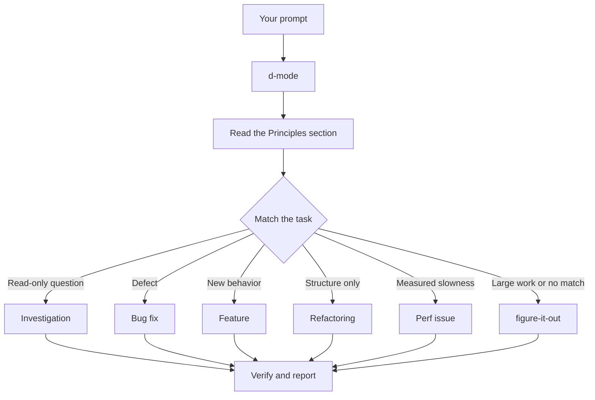

# `/dstack:d-mode`로 작업 보내기

`/dstack:d-mode`는 정문이다. 목표를 주면 플레이북 19개 중 하나를 고르고, 그 플레이북의 단계를 할 일 목록에 옮기고, 단계가 필요로 할 때 다른 스킬을 부른다. 이 쪽에서는 좋은 프롬프트가 어떤 모습인지, 그리고 실제로 얼마나 적게 써도 되는지를 배운다.

## 프롬프트가 거치는 일



도표는 흔한 경로를 보여 준다. 지표 하나를 끌어올리는 Hillclimb, 실행 중인 증상과 이미 받아 둔 추적 자료를 진단하는 Runtime forensics와 Trace forensics, Prototype, 화면 일치를 맞추는 Visual parity, 스킬을 쓰고 평가하는 Authoring a skill과 Eval, Autonomous run, 변경 여러 건을 맡기는 Autopilot, Session pickup, Pause safely, Multi-phase plan, Worktree cleanup 플레이북도 따로 있다. 파일을 바꾸는 모든 플레이북은 Commit and push 플레이북으로 끝난다. [플레이북 폴더](../../skills/d-mode/playbooks/)에 전체가 있다.

## 격식이 아니라 목표를 말한다

명세서를 쓸 필요는 없다. 무엇이 잘못됐는지 또는 무엇을 원하는지, 그리고 에이전트의 시간을 아껴 줄 이미 아는 것을 말한다.

```text
/dstack:d-mode users get two notifications after a retry. repro first, then fix and verify.
```

이것은 Bug fix 프롬프트다. "repro first"는 예의가 아니라 실제 제약이고, 플레이북이 그것을 지킨다. 할 일 목록이 Bug fix 단계로 채워지는 것을 지켜본다.

## 프롬프트에 넣을 것

쓸모 있는 프롬프트에는 최대 다섯 가지가 들어가고, 각각은 한 문장에 들어간다.

- **목표.** 무엇이 잘못됐는지, 또는 무엇을 원하는지 말한다.
- **끝났는지 확인하는 방법.** 통과하거나 실패할 수 있어야 한다. "더 좋게 만들어"나 "한 시간 동안 작업해"는 확인 방법이 아니다.
- **보고 싶은 증거.** 실제 명령 출력, 흐름을 녹화한 영상, 저장된 값, 전후 수치를 요청한다.
- **이미 아는 것.** 증상, 재현 단계, 로그 한 줄, 링크가 있으면 에이전트가 찾는 수고를 덜어 준다.
- **실제 제약.** "repro first", "don't change any code yet", "zero behavior change", "let me review before proceeding"은 각각 에이전트의 행동을 바꾼다.

다섯 가지를 모두 담은 프롬프트 하나다.

```text
/dstack:d-mode the csv export drops its last row since yesterday's deploy. failing job id is 4812. repro first, then fix. done means the 60k-row fixture exports every row. show me the row counts before and after.
```

빼는 편이 좋은 것이 두 가지 있다.

- **방법.** 이루려는 것을 말하고, 사용자가 고를 길보다 나은 길을 에이전트가 찾을 여지를 남긴다. 스킬 목록도 마찬가지이고, 아래 함정에서 다룬다.
- **처음부터 내놓는 원인 추측.** 말해 둔 추측은 가리킨 곳으로 탐색을 좁힌다. 감을 말하기 전에 에이전트가 문제를 먼저 다시 설명하게 한다.

긴 스레드나 모호한 버그처럼 잡음이 많은 보고라면, 다시 설명하게 하는 것을 첫 단계로 삼는다.

```text
/dstack:d-mode read this thread. restate the underlying issue in your own words, in plain english. don't change any code yet.
```

오해는 코드가 생기기 전에, 에이전트가 다시 설명한 내용에서 드러난다. 거기서 바로잡으면 잘못된 수정 한 번 대신 메시지 한 번이 든다. 플레이북 없이 다시 설명만 시키려면 [`/dstack:in-your-own-words`](../../skills/in-your-own-words/SKILL.md)를 실행한다. 에이전트가 이해한 목표와 풀려는 문제를 다시 말해 준다.

프롬프트가 제대로 겨냥했는지 확신이 없으면 보내기 전에 [`/dstack:sharpen`](../../skills/sharpen/SKILL.md)을 돌린다.

```text
/dstack:sharpen write a migration guide for the v2 config format.
```

에이전트는 최고의 전문가라면 요청받지 않은 어떤 일을 했을지, 가장 날것의 어떤 자료에서 시작했을지, 어떤 방법과 도구를 썼을지, 사용자나 에이전트 말고 무엇이 결과가 맞다는 것을 보여 줄지를 말한다. 그런 다음 그것을 정확히 요구하도록 프롬프트를 다시 쓴다. 더 깊게, 그러나 더 크지는 않게 쓴다. 다시 쓴 프롬프트는 실험으로 가를 수 있는 선택을 프로토타입으로 시험하고, 관찰한 결과로 선택지를 추천하라고 요구한다. 제품과 취향에 관한 선택은 사용자에게 남긴다. 작업은 하지 않는다. 다시 쓴 것을 읽고 나서 보낸다. 예를 들어 `/dstack:d-mode`로 보낸다.

무엇을 찾는지 이름을 댈 수 없을 때는 먼저 사용자가 쓴 설명과 파일에 [`/dstack:reframe`](../../skills/reframe/SKILL.md)을 돌린다.

```text
/dstack:reframe the settings page saves some fields right away and others only on submit, and people lose edits.
```

에이전트는 전문 용어 8~12개를 준다. 순서는 각 용어가 만들려는 것을 얼마나 바꾸는지에 따른다. 용어마다 그 용어가 가리키는 설명 부분, 그것을 쓰는 실제 프로젝트(링크를 확인한 것), 그 용어로 에이전트에게 무엇을 요청할 수 있는지가 붙는다. 같은 문제를 다른 이름으로 푼 이웃 분야 2~3곳의 용어도 빌려 오고, 각 비유가 어디서 깨지는지도 말한다. 그런 다음 새 말로 설명을 다시 쓴다. 그 결과를 보내거나 거기에 `/dstack:sharpen`을 돌린다.

## 후속 요청은 짧게

대화가 이미 맥락을 쥐고 있으면 프롬프트는 거의 사라진다. 다음 중 무엇이든 충분하다.

```text
/dstack:d-mode do it
```

```text
continue
```

```text
keep going until done
```

짧아도 되는 것은 플레이북이 구조를 쥐고 있고 스킬이 대화에 남아 있기 때문이다. `d-mode`를 대화에 남기는 방법은 [dstack 설치](./01-setup.md#첫-작업-돌려-보기)에 있다. 사용자의 말은 의도를 싣고, 스킬은 엄밀함을 싣는다.

## "new task"로 작업 바꾸기

긴 대화에는 지난 작업의 맥락이 쌓인다. 주제를 바꿀 때는 그렇게 말한다.

```text
/dstack:d-mode new task. figure out why the cache entry survives logout. don't change any code yet.
```

"new task"는 `/dstack:d-mode`에게 이전 플레이북을 이어 가지 말고 다시 고르라고 알린다. "don't change any code yet"은 이 작업을 Investigation에 고정한다. 이 두 문구가 없으면 Feature 플레이북을 진행 중인 d-mode는 질문을 다음 기능 단계로 받아들이기 쉽다.

## 병렬 작업에는 각자 worktree를 준다

한 컴퓨터의 한 저장소에 에이전트 여러 개를 붙이면 작업 폴더, 포트, 빌드 산출물을 두고 서로 부딪친다. 처음부터 worktree를 요청하면 격리된다.

```text
/dstack:d-mode new task. branch off <base> in a fresh worktree, then port the parser change there.
```

작업마다 브랜치와 worktree를 따로 주면 어떤 에이전트도 다른 에이전트의 파일을 건드리지 않는다. worktree는 디스크와 컴퓨터 자원을 쓰기 때문에 노트북에서는 한 번에 몇 개만 돌릴 수 있다. d-mode는 두 에이전트가 같은 체크아웃에 쓸 수 있으면 worktree 격리로 띄운다. 그래서 대개는 특정 기준 브랜치나 위치가 중요할 때만 이렇게 말하면 된다.

worktree는 쌓인다. 디스크가 빠듯해지면 이렇게 묻는다.

```text
/dstack:d-mode what's eating my disk? prune the worktrees that are safe to prune.
```

[Worktree cleanup 플레이북](../../skills/d-mode/playbooks/worktree-cleanup.md)은 모든 worktree를 병합 상태, 커밋하지 않은 작업, 아직 그 worktree를 건드리는 대화로 분류한다. 그 증거가 허락하는 것만 지우고, 커밋하지 않은 작업이 든 것은 사용자가 정하도록 멈춘다.

## 돌려 두고 자리를 비운다

자리를 비울 때는 무엇이 끝인지 말하고 간다.

```text
/dstack:d-mode im stepping away. keep going until the migration check reports zero old callers. log your decisions.
```

나중에 검토할 작업은 [`/dstack:figure-it-out`](../../skills/figure-it-out/SKILL.md)으로 간다. 이 스킬이 실행의 단계를 설계하고 [`/dstack:show-me-your-work`](../../skills/show-me-your-work/SKILL.md) 결정 기록을 남긴다. 밤샘 계약 전체는 [자는 동안 작업 돌리기](./07-overnight.md)에 있다.

**함정:** 프롬프트에 스킬을 나열하지 않는다(`use /dstack:architect, then /dstack:arena, then /dstack:interrogate...`). 플레이북이 이미 순서를 정해 두었고, 손으로 쓴 순서는 플레이북이라면 남겼을 단계를 뒤섞거나 빼는 일이 많다. 특정 선택을 바꾸고 싶을 때만 스킬 이름을 댄다.

전체 라우팅 규칙은 [`d-mode`](../../skills/d-mode/SKILL.md) 자체를 읽는다.

다음: [코드 이해하기](./03-understand.md).
