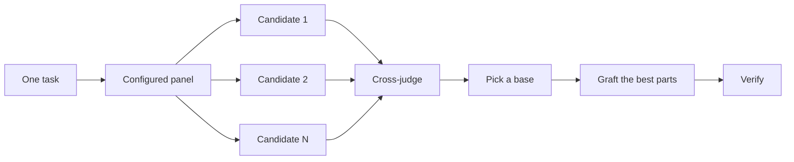

# 코드를 쓰기 전에 설계한다

어려운 설계를 한 번만 시도하면 모델이 처음 떠올린 모양에 갇힌다. `/dstack:architect`는 구현 전에 타입과 경계를 정한다. `/dstack:arena`는 같은 브리프로 여러 번 시도하고 가장 좋은 부분을 합친다. `/dstack:interrogate`는 다른 모델들이 결과를 깨뜨려 보게 한다. 일이 설계 종합이 아니라 범위 확인이라면 `/dstack:swarm`이 조각이나 경주를 나눠 돌리고 결과를 모은다.

가장 흔한 설계 실수 둘은 에이전트의 첫 설계를 그대로 받는 것과, 코드로 시험해 보지 않은 계획을 다듬는 것이다. 이 쪽은 둘 다 고친다. 코드를 통해 계획한다. 프로토타입이 열린 질문에 답하고, README나 튜토리얼이 목표를 정하고, 글로 쓴 계획서는 마지막에 온다.


## `/dstack:architect`로 모양 정하기

```text
/dstack:architect design the import pipeline before writing any code. i care most about how callers use it.
```

[`/dstack:architect`](../../skills/architect/SKILL.md)는 변경이 건드리는 모든 시스템을 먼저 추적한다. 그다음 타입, 시그니처, 모듈 경계를 갖춘 서로 다른 모양 두 개를 스케치하고, 상태마다 주인이 하나이고 일마다 방법이 하나이고 호출자가 알아야 할 것이 가장 적은 쪽을 고른다. 크거나 논쟁이 되는 설계라면 혼자 스케치하지 않고 `/dstack:arena`를 돌린다. 코드를 쓰기 전에 설계를 보고 싶다면 프롬프트에 그렇게 쓴다.

코드가 시작된 뒤에도 설계가 신성하지는 않다. 같은 우회책이 계속 필요해지면 `/dstack:architect`는 덧대지 않고 다시 설계한다.

## `/dstack:arena`로 여러 시도를 나란히 돌리기

```text
/dstack:arena take my prompt to the arena verbatim. i want to compare their proposals with yours.
```

[`/dstack:arena`](../../skills/arena/SKILL.md)는 그 밑의 범용 도구다. 서브에이전트 N개가 같은 설계나 코드 브리프를 병렬로 시도하고, 각자 자기 worktree나 디렉터리에 쓴다. 다른 모델 회사의 읽기 전용 심판이 모든 후보를 기준표로 채점한다. 다른 회사의 모델을 돌릴 수 없으면 조정자가 심판을 건너뛰고 기반을 직접 고른다. 조정자는 후보를 끝까지 읽고, 기반을 고르고, 진 후보의 가장 좋은 아이디어를 접목하고, 결과를 검증한다.



패널은 [`/dstack:setup-dstack`](../../skills/setup-dstack/SKILL.md) 설정에서 오고, 작업마다 조정할 수 있다. 기본 패널은 Fable high, Opus high, codex 세 좌석이다. 결정이 중요하면 후보를 더 요청하고, 아니면 덜 요청한다.

```text
/dstack:arena this, 5 candidates. the cache key format is expensive to change later.
```

## `/dstack:swarm`으로 조각과 경주 맡기기

```text
/dstack:swarm check every package under packages/ against its check.ps1. one worker per package. one report.
```

[`/dstack:swarm`](../../skills/swarm/SKILL.md)은 독립된 조각, 범위 확인 표, 관문 코스, 탐색 분할, 선언된 경주의 갈래에 워커 N개를 나눠 보낸다. 각 워커는 자기 worktree에서 돌고, 자기 범위와 점검을 받아 `PASS`, `ISSUES`, `BLOCKED` 중 하나를 보고한다. 부모는 워커들을 기다렸다가, 빠진 곳이나 이탈한 워커를 포함해 간결한 보고서 하나를 돌려준다.

병렬로 돌려 더 넓은 범위를 확인하거나 독립된 점검끼리 경주시킬 때 쓴다. `/dstack:arena`는 모든 워커에게 같은 설계나 코드 브리프를 주고, 기반을 고르고, 가장 좋은 부분을 접목한다. `/dstack:swarm`은 조각을 맡거나, 선택 규칙을 미리 선언한 경주를 돌린다. 기반 선택과 접목 절차는 쓰지 않는다.

## `/dstack:interrogate`로 깨뜨려 보기

```text
/dstack:interrogate the whole branch, but skeptically. no nitpicks unless it's an actual bug or regression.
```

[`/dstack:interrogate`](../../skills/interrogate/SKILL.md)는 변경과 그 의도를 설정된 모델들의 적대자에게 주고, 각자 실제 코드를 돌려 변경을 깨뜨려 본다. 적대자마다 다른 실패를 찾는다. 지적은 그 명령을 다시 돌렸을 때 의도를 깨는 실패가 보일 때만 살아남는다. 보고서는 검증된 지적마다 찾은 적대자를 적고, 이어서 각 적대자가 무엇을 버렸고 왜 버렸는지를 적고, 아무것도 적용하지 않는다.

Dropped 목록도 읽는다. 판정은 사용자가 뒤집을 수 있다.

## 논쟁 대신 프로토타입

첫 설계를 그대로 받지 않는다. 몇 가지를 요청하고, 눈에 보이는 증거로 고른다.

```text
/dstack:d-mode prototype a few options for the new dropdown menu. take screenshots or videos for me to compare.
```

[Prototype 플레이북](../../skills/d-mode/playbooks/prototype.md)은 버릴 스케치를 임시 디렉터리에 만들고, 변형들을 전환기 하나 뒤에 놓고, 각각을 돌려 보고, 스크린샷이나 측정값을 남긴다. UI뿐 아니라 동작과 알고리즘에도 쓸 수 있다. 프로토타입은 코드로 하는 계획이다. 에이전트가 사용자에게 묻는 대신 무언가를 돌려서 스스로 열린 질문에 답하게 하고, 사용자가 떠올리지 못했을 선택지가 들어올 여지를 남긴다.

같은 생각은 실제 설계로 커진다. `/dstack:architect`에 프로토타입을 짝지우고 검토 관문을 유지한다.

```text
/dstack:d-mode we need rate limiting for external webhooks. /dstack:architect it first, and answer open questions with prototypes. let me review before proceeding.
```

추상적인 계획에 적대자를 쓰지 않는다. `/dstack:interrogate`는 실행으로 증명되지 않은 지적을 모두 버리므로, 뒷받침하는 코드가 없는 계획은 깨뜨릴 것이 거의 없다. 질문은 프로토타입이 정리하게 하고, 만들어진 것을 검토한다.

## 공유 코드는 README부터 쓴다

다른 코드가 쓸 패키지나 API라면 사용자가 읽을 문서부터 시작한다.

```text
/dstack:d-mode write a tutorial for how i would use the new config package first. then /dstack:teach me why it beats the current one.
```

튜토리얼을 먼저 쓰면 호출자의 시점이 강제된다. 가상의 사용자에게 API를 설명하면서 구현으로 거슬러 간다. 문서는 에이전트가 자기 작업을 대조하는 구체적인 목표도 된다. 문서 자체가 중요할 때는 [`/dstack:technical-writing`](../../skills/technical-writing/SKILL.md)을 지정한다. 그래야 튜토리얼이 튜토리얼로 남고, 참조와 설명이 한꺼번에 섞여 흐려지지 않는다.

## 설계가 정해진 뒤 계획서를 쓴다

dstack에는 계획 스킬이 일부러 없다. 글로 쓴 계획서가 필요하면 설계가 정해진 뒤에 요청한다.

```text
/dstack:d-mode turn this design into a plan. small verifiable commits, each with its own verification steps.
```

[Multi-phase plan 플레이북](../../skills/d-mode/playbooks/multi-phase-plan.md)은 남은 열린 질문을 프로토타입으로 정리한 뒤, 변경 단위마다 한 절을 쓰고, 각 절은 그 변경이 동작한다는 증거로 끝난다. 테스트가 통과한다는 것만으로는 그 증거가 되지 않는다. 계획서가 산출물이다. 플레이북은 구현하지 않고, 사용자가 시작하라고 말해야 실행이 시작된다.

마이그레이션이라면 프롬프트에 기준을 적는다.

```text
/dstack:d-mode plan the migration of our ui library to the new styling system. small verifiable commits, each with visual regression checks. the result must match the original exactly, bugs included.
```

"bugs included"는 마이그레이션이 가는 길에 슬쩍 무언가를 고쳐서 옛 출력과 새 출력을 비교할 수 없게 되는 일을 막는다. 며칠에 걸친 프로젝트라면 다른 에이전트가 진행 중인 작업을 볼 수 있도록 계획서를 한동안 저장소에 커밋해 둘 수 있다. 작업이 main에 올라가면 지운다.

## 작업에 설계를 얼마나 들일까

모든 변경에 이것이 필요한지 궁금할 수 있다. 아니다. 대부분의 변경에는 하나도 필요 없다. 대략의 사다리는 이렇다.

- 작고 끝난 변경이 못 미더우면 `/dstack:interrogate` 하나면 된다.
- 함수 경계를 넘거나 소유권을 옮기는 변경은 `/dstack:architect`를 받을 만하고, 설계가 크거나 논쟁이 되면 `/dstack:arena`가 딸려 온다.
- 이름, 형식, 알고리즘처럼 독립된 시도가 도움이 되는 단독 결정은 바로 `/dstack:arena`다.
- 범위 확인 표, 병렬 점검 모음, 갈래를 미리 선언한 경주는 `/dstack:swarm`이다.
- 레이아웃, 측정 시간, 접근 방식처럼 돌려 보면 답이 나오는 열린 질문은 논쟁이 아니라 프로토타입이다.
- 되돌리기 비싼, 논쟁이 되는 설계는 `/dstack:architect`를 거치고, push 전에 `/dstack:interrogate`를 거친다.
- 여러 변경 단위에 걸친 작업은 설계가 정해진 뒤 계획서를 쓴다.

`/dstack:d-mode`는 이미 이 사다리를 적용한다. 경계를 넘는 작업은 알아서 `/dstack:architect`를 부르므로, 이것들을 직접 부르는 것은 주로 기본보다 더 많거나 적은 검토를 원할 때다.

다음: [변경 만들고 정리하기](./05-build-and-clean.md).
