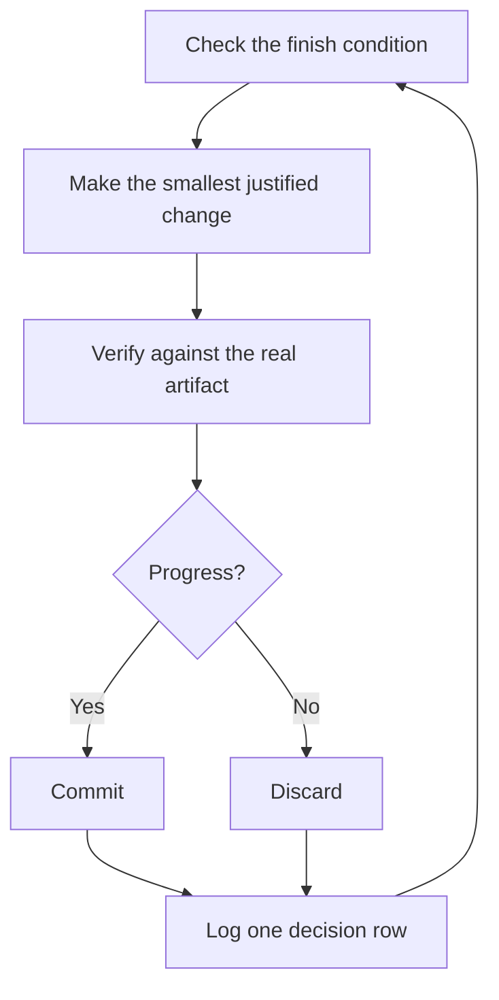

# 자는 동안 작업 돌리기

앞에서 한 모든 일이 결실을 보는 곳이다. 자기 작업을 직접 검증한다고 믿을 수 있는 에이전트는 어려운 작업을 맡기고 혼자 둘 수 있는 에이전트다. 그것을 안전하게 만드는 것은 희망이 아니다. 확인할 수 있는 종료 조건, 격리된 worktree, 아침에 감사하는 결정 기록이다.


## 루프 전에 신뢰를 쌓는다

믿지 못하는 루프는 확인되지 않은 작업을 더 빨리 만들 뿐이고, 엉망은 반복마다 불어난다. 루프를 돌려 두고 떠나기 전에 그럴 자격을 얻었는지 확인한다.

- 그 작업을 직접 한 번 해 봤거나 에이전트가 하는 것을 지켜봐서 좋은 결과가 어떤 모습인지 안다.
- 에이전트가 사용자가 쓸 도구와 신호를 가지고 있다. 검증 스킬, 프로파일러, 로그다.
- 모든 단계가 자기 작업을 증명하고, 작업이 기준에 못 미치면 라인을 멈출 수 있다.
- 대화록을 몇 개 읽고 반복되는 실패를 도구, 스킬, 점검으로 바꿨다.

네 가지가 모두 성립한 뒤에야 루프를 자율로 만든다. 그때까지는 지켜보면서 돌린다.

## 밤샘 계약

좋은 인수인계에는 목표, 종료 조건, 권한, 탈출구가 있다. 길 필요는 없다.

```text
/dstack:d-mode im going to bed. migrate every caller to the new parser in a fresh worktree off <base>.
done means zero old callers, all parser fixtures pass, old api deleted.
keep a decision log. don't ask me before committing.
/loop until done. if you're truly stuck after a few hours, stop and write up why.
```

각 줄이 무슨 일을 하는지 차례로 본다.

- "im going to bed"는 세션 재정의다. 에이전트가 묻기를 멈추고 계속 간다.
- "done means..."는 목표를 매 반복이 돌릴 수 있는 점검으로 바꾼다.
- "fresh worktree off `<base>`"는 열어 둔 다른 작업과 실행이 부딪치지 않게 한다.
- "don't ask me before committing"은 에이전트가 원래라면 멈춰 서서 기다렸을 허가를 미리 답해 둔다.
- `/loop`는 Claude Code 기본 명령이고 dstack 스킬이 아니다. [Autonomous run 플레이북](../../skills/d-mode/playbooks/autonomous-run.md)이 이것으로 이벤트나 주기마다 종료 조건을 다시 확인한다.
- 탈출구는 진짜 막다른 곳에서 멈추고 이유를 적게 한다. 여덟 시간 동안 목표를 창의적으로 재해석하는 것보다 낫다.

자리를 비운 뒤에 검토할 작업이므로 `/dstack:d-mode`는 이것을 [`/dstack:figure-it-out`](../../skills/figure-it-out/SKILL.md)으로 보낸다. 코드가 나오기 전에 실행의 단계를 설계하고 결정 기록을 연결하는 스킬이다.

실행을 일부러 멈추려면 에이전트에게 멈추라고 하거나, 곧 오프라인이 되거나 Claude Code를 다시 시작한다고 말한다. [Pause safely 플레이북](../../skills/d-mode/playbooks/pause-safely.md)이 현재 단계를 끝내거나 되돌리고, push하지 않은 채 `wip:` 체크포인트를 커밋하고(현재 브랜치가 main이면 먼저 `d/wip-<slug>` 브랜치로 옮긴다), 이어받기 메모를 쓴다. 새 대화가 Session pickup 플레이북으로 그 메모에서 작업을 이어받는다. "keep going"이라고 말해서 멈춤이 일어나는 일은 없다.

## 루프가 밤새 하는 일



반복마다 변경 하나, 점검 하나, 기록 한 줄이다. 도움이 되지 않은 변경은 남겨 두지 않고 버린다. 정체는 멈춤이 아니라 방향 전환을 뜻하고, 종료 조건은 승리를 선언하려고 슬그머니 느슨해지지 않는다.

## 아침의 감사

[`/dstack:show-me-your-work`](../../skills/show-me-your-work/SKILL.md)가 실행을 검토할 수 있게 만든다. 각 행은 시각, 단계, 결정, 이유, 증거 포인터, 결과를 `decisions.tsv`에 TSV로 기록한다(여러 실행이 한 폴더를 쓰면 `.audit/<task-slug>.tsv`). 기본적으로 로컬에 남는다. 검토자가 결과를 믿으려면 흔적이 필요할 만큼 야심 찬 작업이라면 커밋한다.

돌아오면 실행을 검토 형태로 요청한다.

```text
/dstack:show-me-your-work catch me up on what you did last night
```

스킬은 요약을 돌려주기 전에 다른 모델 계열의 검토자를 띄워 기록과 대화록을 읽게 하고, 답은 살펴봐야 할 것을 나열한 Attention 절로 끝난다. 그 절을 먼저 읽고, 그것이 가리키는 기록 행을 읽는다. 밤 전체를 다시 읽는 것이 아니라 결정을 감사하는 것이다.

감사가 아니라 빠른 상태만 필요하면 작업을 돌린 대화에서 [`/dstack:ketchup`](../../skills/ketchup/SKILL.md)을 실행한다. 읽기만 하고, 마지막 메시지 이후 무엇이 바뀌었는지를 쉬운 말로, 작업이 만든 스크린샷과 작은 도해와 함께 알려 준다. 그런 다음 사용자를 기다리는 결정마다(예를 들어 push, 승인, 선택지 사이의 선택) 추천, 증거, 위험을 나열하므로 답만 보고 결정할 수 있다.

## 밤에 맡길 일이 작업 하나가 아니라 큐일 때

위의 계약은 작업 하나를 종료 조건 하나까지 끌고 간다. 어떤 밤에는 더 많다. 서로 독립인 변경의 큐나 프로그램 전체다. 플레이북 하나와 스킬 하나가 같은 신뢰를 더 크게 키운다.

[Autopilot 플레이북](../../skills/d-mode/playbooks/autopilot.md)은 서로 독립인 변경의 큐를 main에 올리는 데까지 끌고 간다. 항목마다 담당 에이전트 하나가 자기 worktree에서 빌드하고 증명해 브랜치와 SHA를 보고한다. 담당 에이전트는 push하지 않고 main도 건드리지 않는다. 코드를 쓰지 않은 검증 에이전트가 올릴 패치를 증명해야 하고, 증명된 항목만 큐 순서대로 하나씩 main에 올라간다. 판정은 패치 하나에 대한 것이므로 rebase가 패치를 바꾸면 push 전에 다시 검증한다.

```text
/dstack:d-mode full autopilot on this queue. each item is independent. i want them pushed by morning.
```

직접 올리고 싶으면 프롬프트에 "don't push"라고 쓴다. 그러면 모든 항목이 검증된 상태로 자기 브랜치에 남고, 아침에 항목마다 판정과 함께 받아서 사용자가 직접 검토하고 올린다. 올리기 전에 사용자가 직접 확인하고 싶을 때 이 방식을 고른다.

```text
/dstack:d-mode autopilot these five changes, but don't push. i'll land them in the morning.
```

여러 패키지에 걸친 마이그레이션 같은 프로그램 전체에는 따로 플레이북이 없다. `/dstack:d-mode`는 크거나 여러 곳에 걸친 작업을 [`/dstack:figure-it-out`](../../skills/figure-it-out/SKILL.md)으로 보내고, 이 스킬이 그 작업을 위한 엄밀한 실행 하나를 설계한다.

```text
/dstack:d-mode migrate every package to the new store. own it until each one is converted and pushed. i'll check in twice a day.
```

**함정:** 기간은 종료 조건이 아니다. "work on this for 4 hours"는 에이전트에게 확인할 것을 주지 않고, 결과 대신 네 시간의 움직임을 보게 된다. `/loop`에는 통과하거나 실패할 수 있는 술어를 준다.

다음: [원칙 이름으로 조종하기](./08-principles.md).
